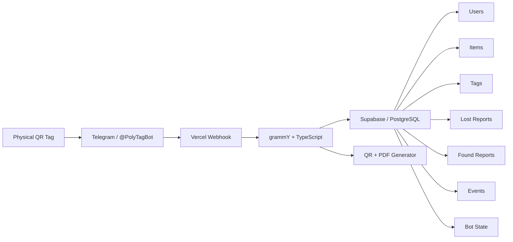

<div align="center">

# PolyTag

### A lightweight, privacy-first lost & found system for campus life

**QR tags · Telegram · Anonymous return flow · Supabase · Vercel**

[](https://t.me/PolyTagBot)
[](https://www.typescriptlang.org/)
[](https://supabase.com/)
[](https://vercel.com/)
[](LICENSE)

**[How it works](#how-it-works) · [Features](#what-works-today) · [Quick start](#quick-start) · [Deploy](#deploy-to-vercel) · [Roadmap](#roadmap)**

</div>

---

## Why PolyTag?

Losing something on campus is easy. Returning it is usually the harder part.

A student finds a set of keys, a card, or a phone. They may not know who owns it, where the lost-and-found office is, or whether posting in a group chat is worth the effort. In practice, a lot of found items stay where they are simply because returning them takes too many steps.

PolyTag is built around a simple idea:

> **Make helping someone return a lost item take only a few seconds.**

An owner attaches a PolyTag QR sticker to an item. If the item is lost, the finder scans the tag, opens the official Telegram bot, and sends one short message. The owner is notified without either side having to share a phone number or Telegram username.

The project is currently in beta and is being developed for a university campus pilot.

---

## How it works

```text
Owner registers an item
        ↓
PolyTag creates a unique ID + QR sticker
        ↓
Sticker is attached to the item
        ↓
Someone finds the item
        ↓
Finder scans the QR
        ↓
@PolyTagBot opens in Telegram
        ↓
Finder sends one short message
        ↓
Owner receives an anonymous notification
```

If the owner has already marked the item as lost, the finder sees that the owner is actively looking for it.

Once the item is returned, the owner can mark it as recovered and PolyTag closes the related reports.

---

## What works today

### 🏷 Item registration

Users can register common item types such as:

- Keys
- Bags
- Laptops
- Phones
- Cameras
- ID / cards
- Other personal items

PolyTag generates a random public ID such as:

```text
PT-UNHZY5TH
```

The public tag does not expose the owner's Telegram ID, phone number, or personal details.

### 📱 QR sticker generation

For every registered item, PolyTag automatically creates:

- a QR sticker image
- a printable **50 × 30 mm PDF**
- a human-readable PolyTag ID as a fallback

The QR opens the official Telegram bot with the tag ID already attached to the deep link.

### 🔔 Anonymous finder → owner notification

The finder can send a short message such as:

```text
I found it near the library entrance.
```

The owner receives the message through PolyTag. The finder's Telegram username and phone number are not shared.

### 🚨 Lost Mode

Registered items move through a simple recovery lifecycle:

```text
ACTIVE → LOST → FOUND → RECOVERED
```

Owners can mark an item as lost, record where they last saw it, receive finder reports, and confirm when the item has been recovered.

### 🌍 Multilingual experience

The default interface language is **Russian**, with persistent language preferences for:

- 🇷🇺 Russian
- 🇬🇧 English
- 🇸🇦 Arabic
- 🇨🇳 Chinese
- 🇻🇳 Vietnamese
- 🇪🇸 Spanish
- 🇫🇷 French

The owner and finder can use different languages at the same time.

### 🛡 Trust-first QR flow

QR codes can make people understandably cautious, so PolyTag makes the destination visible and keeps the flow simple.

Official PolyTag stickers:

- visibly show `t.me/PolyTagBot`
- open only the official Telegram bot flow
- never ask for a Telegram password or login code
- never ask for payment or bank-card information
- include a manual PolyTag ID for users who prefer not to scan

PolyTag does **not** claim that arbitrary QR codes are safe. The goal is to make official PolyTag tags easy to verify.

### 🧾 Persistent event history

Important actions are stored in PostgreSQL, including:

```text
ITEM_REGISTERED
STICKER_GENERATED
TAG_SCANNED
ITEM_REPORTED_LOST
FOUND_REPORT_CREATED
ITEM_RECOVERED
```

This gives the project a clean audit trail and will support campus analytics later.

---

## Architecture



PolyTag is intentionally a small modular backend rather than a collection of microservices. That keeps the beta easy to understand and deploy while leaving room to separate services later if the project grows.

---

## Tech stack

| Layer | Technology |
|---|---|
| Telegram bot | [grammY](https://grammy.dev/) |
| Language | TypeScript / Node.js |
| Database | Supabase PostgreSQL |
| QR generation | `qrcode` |
| Sticker rendering | `sharp` |
| Printable PDF | `pdf-lib` |
| Production hosting | Vercel Serverless Functions |
| Local development | grammY long polling |
| Production delivery | Telegram Webhook |

---

## Database model

The current database includes:

```text
app_users
items
tags
lost_reports
found_reports
events
bot_states
```

A few design choices are intentional:

- Telegram identifiers stay separate from public tag IDs.
- Tags use random opaque tokens instead of sequential IDs.
- Row Level Security is enabled on application tables.
- The Supabase secret key is used only on the server.
- Temporary multi-step Telegram state is stored in PostgreSQL so serverless requests do not lose the conversation flow.

---

## Quick start

### Requirements

You will need:

- Node.js 20+ recommended
- a Telegram bot created with [@BotFather](https://t.me/BotFather)
- a Supabase project
- Git

### 1. Clone the repository

```bash
git clone https://github.com/MarwanMAlfalah/PolyTag_App.git
cd PolyTag_App
npm install
```

### 2. Create the database

For a fresh Supabase project, open:

```text
Supabase Dashboard → SQL Editor
```

Run:

```text
supabase/schema.sql
```

Then run:

```text
supabase/migrations/v0.6.1-vercel.sql
```

The second migration creates persistent bot conversation state for webhook/serverless deployments.

> If you already have a PolyTag database, use the migration files instead of rerunning the full schema.

### 3. Configure environment variables

Copy the example file:

```bash
cp .env.example .env
```

Then fill in:

```env
BOT_TOKEN=YOUR_BOTFATHER_TOKEN
BOT_USERNAME=PolyTagBot

SUPABASE_URL=https://YOUR_PROJECT_REF.supabase.co
SUPABASE_SECRET_KEY=sb_secret_YOUR_SERVER_KEY

WEBHOOK_SECRET_TOKEN=YOUR_RANDOM_WEBHOOK_SECRET
```

Generate a webhook secret locally with:

```bash
openssl rand -hex 32
```

> Never commit `.env`, your Telegram token, or your Supabase secret key.

### 4. Run locally

If the bot is currently using a production webhook, delete it first:

```bash
npm run webhook:delete
```

Then start local polling:

```bash
npm run dev
```

Expected output:

```text
Checking Supabase connection...
Supabase database is ready.
PolyTag bot is running as @PolyTagBot
```

---

## Deploy to Vercel

PolyTag is prepared to run as a Telegram webhook on Vercel.

### 1. Import the repository

In Vercel:

```text
Add New → Project → Import Git Repository
```

Select `PolyTag_App`.

Use:

```text
Framework Preset: Other
```

### 2. Add environment variables

Add the following in the Vercel project settings:

```text
BOT_TOKEN
BOT_USERNAME
SUPABASE_URL
SUPABASE_SECRET_KEY
WEBHOOK_SECRET_TOKEN
```

### 3. Deploy

After deployment, verify the health endpoint:

```text
https://YOUR-PROJECT.vercel.app/api/health
```

### 4. Register the Telegram webhook

From your local project:

```bash
npm run webhook:set -- https://YOUR-PROJECT.vercel.app/api/bot
```

Check the webhook:

```bash
npm run webhook:info
```

Once the webhook is active, your laptop no longer needs to stay online for the bot to work.

---

## Project structure

```text
PolyTag_App/
├── api/
│   ├── bot.ts                 # Telegram webhook endpoint
│   └── health.ts              # deployment / database health check
│
├── scripts/
│   ├── setWebhook.ts
│   ├── deleteWebhook.ts
│   └── webhookInfo.ts
│
├── src/
│   ├── bot.ts                 # main bot behavior
│   ├── local.ts               # local polling entry point
│   │
│   ├── bot/
│   │   ├── keyboards.ts
│   │   └── state.ts
│   │
│   ├── db/
│   │   └── supabase.ts
│   │
│   ├── i18n/
│   │   └── index.ts
│   │
│   ├── repositories/
│   │   └── polytagRepository.ts
│   │
│   └── services/
│       ├── stickerService.ts
│       └── tagToken.ts
│
├── supabase/
│   ├── schema.sql
│   └── migrations/
│
├── .env.example
├── package.json
├── tsconfig.json
└── vercel.json
```

---

## Roadmap

The current beta focuses on the core tagged-item recovery flow. The next parts are deliberately being added one at a time so they can be tested with real users.

### Next

- 📍 **Location QR** — report an item found in a room, hallway, library, or dorm area with minimal typing
- 📦 **PolyTag Drop-Box** — track untagged found items deposited at approved campus locations
- 🔎 **Lost ↔ found matching** — category, time, and location-based candidate matching
- ✅ **Ownership verification** — private details used to reduce false claims

### Later

- 📲 Telegram Mini App
- 🗺 Campus location management
- 🧑‍💼 Staff/admin dashboard
- 📊 Recovery analytics and lost-item hotspots
- 🖼 Image-assisted matching
- 🏫 Multi-campus support

---

## Design principles

PolyTag is being built around a few rules that are easy to say and surprisingly hard to keep:

**Finder friction should stay close to zero.**  
A finder should be able to help without creating an account, filling a long form, or learning how the system works first.

**Privacy by default.**  
Returning a lost item should not require strangers to exchange personal contact details.

**The physical and digital parts must agree.**  
A QR sticker, a Telegram conversation, and a database record should always refer to the same item.

**Build for the pilot, not for imaginary scale.**  
The current architecture is intentionally simple. Features are added when the real campus flow needs them.

---

## Pilot status

PolyTag is currently a **student-built beta** intended for controlled campus testing.

It is **not yet an official university service**, and the repository should be treated as active development software.

Feedback from real finders and item owners is more useful to this project than adding features for their own sake.

If something feels slow, confusing, or unnecessary, that is exactly the kind of feedback we want.

---

## Contributing

Issues, ideas, and small focused pull requests are welcome.

If you want to contribute, please keep changes aligned with the project's main goal:

> Help a finder do the right thing with the least possible effort.

For larger changes, opening an issue first is usually the easiest way to keep the implementation consistent with the campus pilot.

---

## Security

Please do not open a public issue containing:

- bot tokens
- Supabase secret keys
- private database credentials
- personal Telegram data from real users

If a credential is accidentally committed, rotate it immediately rather than only deleting it from the latest commit.

---

## License

PolyTag is released under the [MIT License](LICENSE).

---

<div align="center">

### Lost something? Finding the owner should be the easy part.

Built as a practical campus experiment — one QR scan at a time.

</div>
